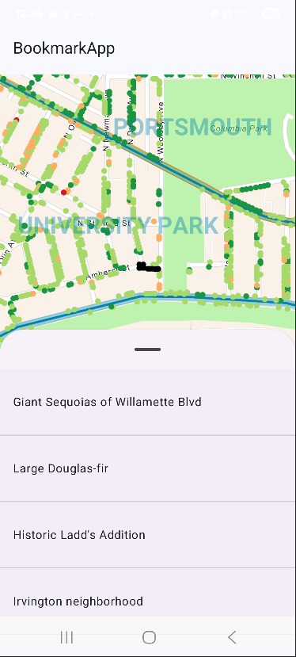

# Bookmarks

## Description

The `BookmarksListView` composable displays the bookmarks from a map or scene. You can provide custom behavior when selecting a bookmark, such as animating in the associated `GeoView` to the bookmark's viewpoint.



## Features

- Displays a scrollable list of bookmarks.
- Provides an `onBookmarkSelected` callback for responding to selections.
- Shows an empty state when there are no bookmarks.
- Allows customization of the background color, text style, and layout modifier.

## Usage

*View the Toolkit API Reference for the `bookmarks` module [here](https://developers.arcgis.com/kotlin/toolkit-api-reference/arcgis-maps-kotlin-toolkit/com.arcgismaps.toolkit.bookmarks/index.html).*

Use the `BookmarksListView` in conjunction with a `GeoViewProxy` from a map or scene to maintain a list of points of interest. For example, to navigate to the GeoViewProxy's bookmark viewpoints, after loading a map, pass in the bookmarks and display the component alongside a `MapView`:

```kotlin
@Composable
fun MapWithBookmarks(arcGISMap: ArcGISMap) {
    
    // A public webmap with bookmarks
    val portalItem = PortalItem(
        Portal.arcGISOnline(Portal.Connection.Anonymous),
        "16f1b8ba37b44dc3884afc8d5f454dd2"
    )
    val arcGISMap = remember { ArcGISMap(portalItem) }
    
    val mapViewProxy = remember { MapViewProxy() }
    
    // Bookmarks from webmap
    val bookmarks = remember(arcGISMap) { mutableStateListOf<Bookmark>() }
    LaunchedEffect(arcGISMap) {
        arcGISMap.load().onSuccess {
            bookmarks.clear()
            bookmarks.addAll(arcGISMap.bookmarks)
        }
    }

    // Create a container to show BookmarksListView with the composable MapView
    val scope = rememberCoroutineScope()
    BottomSheetScaffold(
        sheetContent = {
            BookmarksListView(
                bookmarks = bookmarks,
                modifier = Modifier.weight(1f),
                onBookmarkSelected = { bookmark ->
                    val viewpoint = bookmark.viewpoint
                    if (viewpoint != null) {
                        scope.launch {
                            mapViewProxy.setViewpointAnimated(viewpoint, 1.0.seconds)
                        }
                    }
                }
            )
        },
        ...
    ) { padding ->
        MapView(
            modifier = Modifier
                .padding(padding)
                .fillMaxSize(),
            arcGISMap = arcGISMap,
            mapViewProxy = mapViewProxy
        )
    }
}
```

The map must be loaded before reading its bookmarks. To add or remove bookmarks later, update the `SnapshotStateList`; the list recomposes when its contents change. The callback is optional.

Use `backgroundColor` and `textStyle` to customize the list's appearance:

```kotlin
BookmarksListView(
    bookmarks = bookmarks,
    backgroundColor = MaterialTheme.colorScheme.surface,
    textStyle = MaterialTheme.typography.titleMedium
)
```
